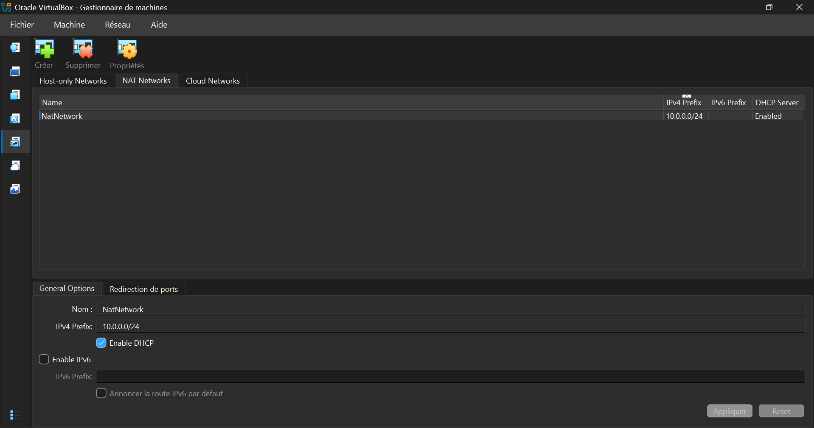
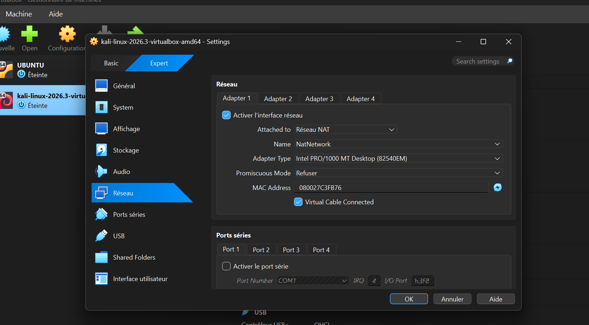
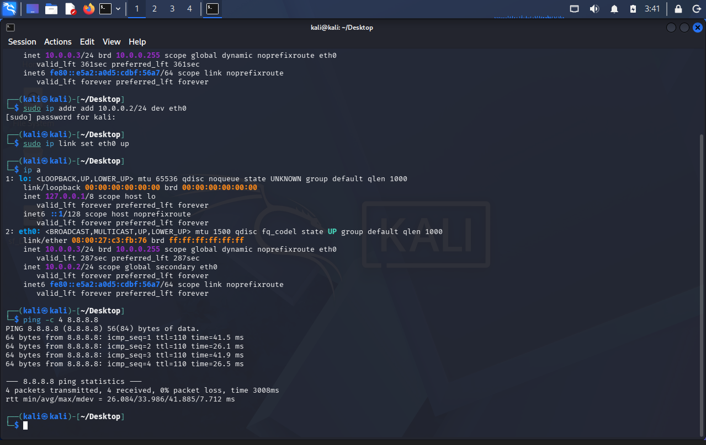

# 🛡️ Cybersecurity Lab Environment Setup
**Networkwalks Internship - Batch B084**

## 📖 Project Overview
Welcome to my Week 1 project! This repository documents the setup of my personal virtual cybersecurity laboratory. The goal was to create a safe, isolated environment using **VirtualBox** and **Kali Linux** to practice penetration testing.

## 📂 Repository Structure
- `README.md`: Project overview (this file).
- `notes/`: Contains detailed technical notes.

## ⚙️ Technical Specifications
| Component | Details |
| :--- | :--- |
| **Host OS** | Windows |
| **Virtualization** | Oracle VirtualBox 7.2 |
| **Attacker Machine** | Kali Linux (2026.3) |
| **Network Type** | NAT Network (`10.0.0.0/24`) |
| **Kali IP** | `10.0.0.2/24` (Static) |
| **Gateway** | `10.0.0.1` |

## 📸 Proof of Work (Screenshots)

### 1. NAT Network Configuration (10.0.0.0/24)
*Setting up the custom NAT Network in VirtualBox.*

### 2. Virtual Machine Network Settings
*Configuring the Kali VM to use the NAT Network and Shared Folders.*

### 3. Kali Linux Terminal (IP & Internet Test)
*Successfully assigning the static IP `10.0.0.2` and verifying internet connectivity with a ping to 8.8.8.8.*

## 🧠 Detailed Notes & Troubleshooting
For a step-by-step breakdown of the commands used and the issues I faced (like the DHCP IP issue), please read my detailed notes:
👉 **[Click here to read the Week 1 Notes](notes/week1-notes.md)**

---
*Created by **Houda Benomar** - Cybersecurity Intern at Networkwalks*
